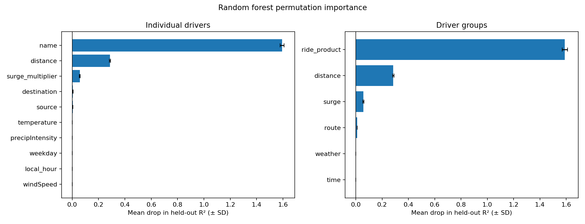
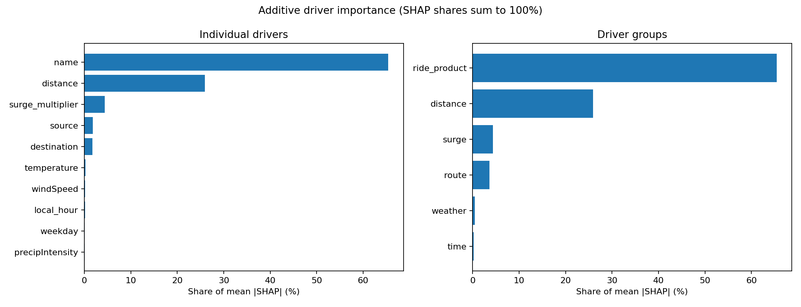
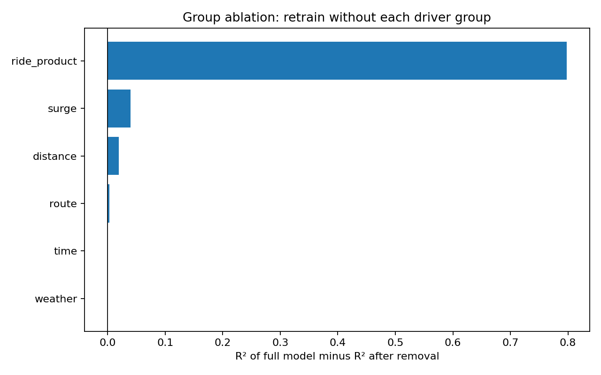
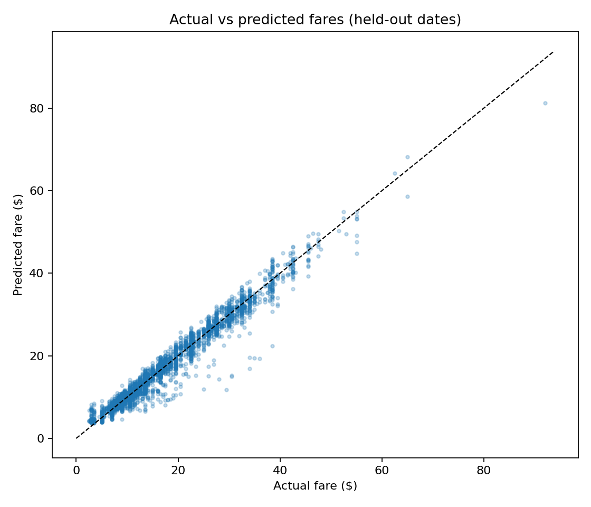
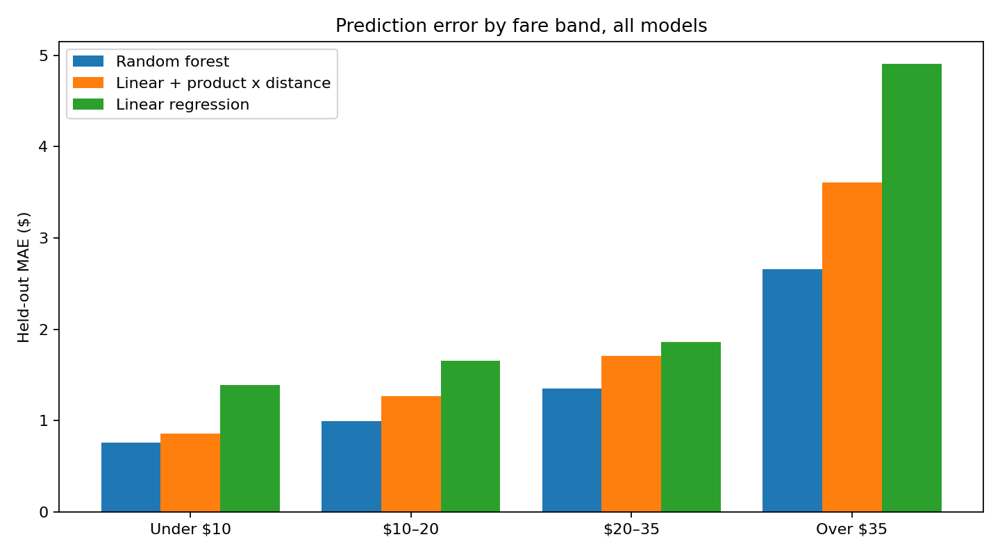
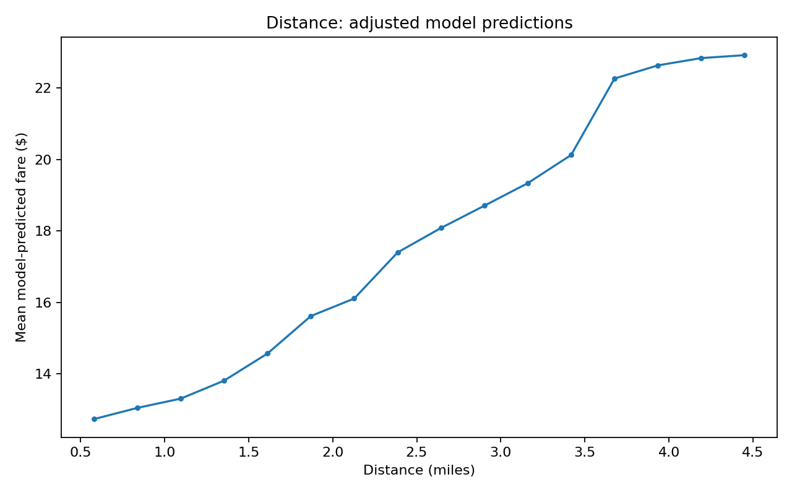
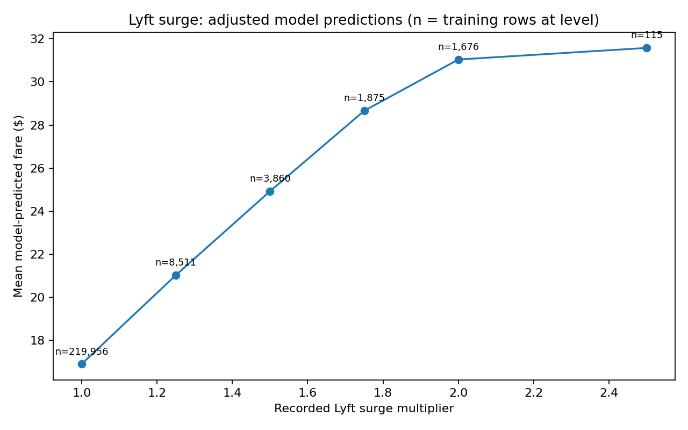
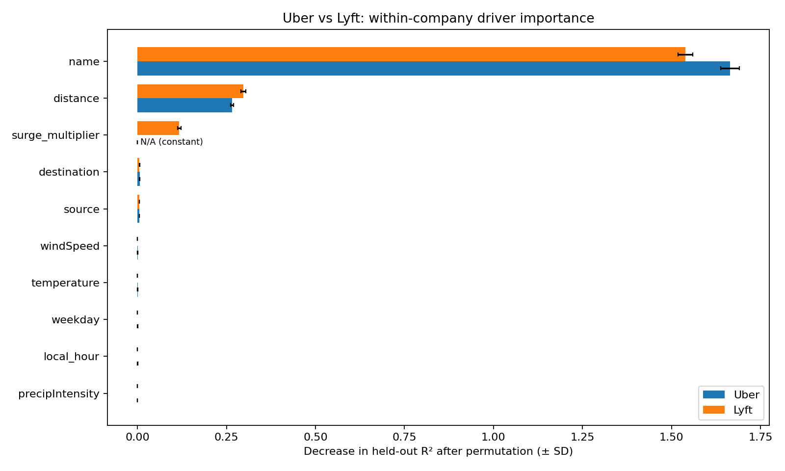

# Key Drivers of Uber and Lyft Ride Prices in Boston

## Abstract

This study investigates the factors most strongly associated with quoted Uber and Lyft ride prices in Boston, Massachusetts, using historical observations from November 25 to December 18, 2018. The analysis combines exploratory data analysis (EDA), SQL-based cleaning and feature preparation, linear regression, Random Forest regression, permutation importance, SHAP-based importance shares, and several follow-up evaluations. After cleaning, the dataset contains **637,976 priced quotes**. A Random Forest trained on 200,000 quotes achieved an **R² of 0.9672** and a **mean absolute error (MAE) of $1.08** on a chronologically held-out test set. Across the importance, ablation, SHAP, and company-specific analyses, **ride product** emerged as the strongest predictor of price (about 65% of the model's attributed contribution), followed by **trip distance** (about 26%) and **recorded surge multiplier** (about 4%). Route, weather, and time variables contributed little additional predictive information once the leading factors were included. These are predictive associations, not causal estimates of pricing decisions.

## 1. Research question

> **What are the key factors associated with rideshare pricing, and how important is each factor in explaining price variation?**

Rather than predicting fares alone, the objective is to **identify and rank the characteristics that contribute to price variation**, examine how their relationships with predicted fares behave, and determine whether the conclusions are consistent across validation approaches and across Uber and Lyft.

## 2. Data

The analysis uses the [**Uber and Lyft Dataset Boston, MA** on Kaggle](https://www.kaggle.com/datasets/brllrb/uber-and-lyft-dataset-boston-ma?resource=download). It contains historical **fare quotes**, not confirmed completed-trip transactions.

| Dataset characteristic | Value |
| --- | ---: |
| Raw observations | 693,071 |
| Original columns | 57 |
| Observations with recorded prices | 637,976 |
| Missing-price observations | 55,095 |
| Uber priced quotes | 330,568 |
| Lyft priced quotes | 307,408 |
| Geographic and temporal scope | Boston, MA; Nov. 25–Dec. 18, 2018 (Boston local time) |

The recorded variables include ride product, quote price, estimated distance, pickup and destination locations, timestamp, surge multiplier, and associated weather conditions. All missing-price observations are associated with the Uber Taxi product, which was excluded from fare modeling because no price was recorded.

### Obtaining the data

**The data files are not included in this GitHub repository because they exceed practical GitHub file-size limits.** They are excluded using `data/.gitignore`. To reproduce the analysis:

1. Download the dataset from the [original Kaggle page](https://www.kaggle.com/datasets/brllrb/uber-and-lyft-dataset-boston-ma?resource=download).
2. Extract the file **`rideshare_kaggle.csv`** into the repository's `data/` directory.
3. Run `preprocessing.sql` to generate **`data/rideshare_model.csv`** locally.

The preprocessed CSV is **generated output**, not a separate external data source. Keep both CSVs in `data/` locally; neither needs to be committed to GitHub.

## 3. Methodology

### 3.1 Exploratory data analysis

The EDA examined dataset completeness, fare distributions, differences between ride products, associations with distance and surge pricing, route-level variation, weather and time patterns, and numerical correlations.

Several observations shaped the modeling plan:

- Prices were **right-skewed** (mean **$16.55**, median **$13.50**). Expensive observations were retained, with error by fare band evaluated later rather than removing plausible premium-service prices as outliers.
- Unadjusted product averages varied widely: approximately **$6.03 for Lyft Shared**, **$9.77 for UberX**, and **$32.32 for Lyft Lux Black XL**. Ride product was therefore retained as a categorical predictor.
- Distance and surge multiplier had the strongest marginal linear correlations with price among the examined numerical features (approximately **0.345** and **0.240**, respectively).
- Weather and local-hour patterns appeared much weaker in descriptive comparisons. They were nevertheless retained to test whether they contributed information after controlling for other factors.

The EDA notebook documents these observations and the resulting feature-selection decisions in more detail: [`src/first_stage_analysis/eda.ipynb`](src/first_stage_analysis/eda.ipynb).

### 3.2 SQL cleaning and feature preparation

The [DuckDB SQL preprocessing script](src/first_stage_analysis/preprocessing.sql) reads the raw CSV, casts selected fields, excludes records with invalid or missing modeling inputs, deduplicates records by quote identifier, and converts timestamps into **America/New_York** local dates, hours, and weekdays. It then exports the cleaned modeling data without modifying the original CSV.

The target is **`price`**. The predictors are:

| Driver group | Features |
| --- | --- |
| Ride product | `name` |
| Trip length | `distance` |
| Surge | `surge_multiplier` |
| Route | `source`, `destination` |
| Time | `local_hour`, `weekday` |
| Weather | `temperature`, `precipIntensity`, `windSpeed` |

The platform identifier `cab_type` was not included as an additional predictor in the pooled model because product names already identify their corresponding platform. It was retained for the separate Uber and Lyft analyses. Categorical inputs were one-hot encoded within scikit-learn pipelines fitted on the respective training samples; numerical inputs were passed through unscaled, since tree models do not require scaling. The data loading, chronological split, feature lists, and model definition are shared by all scripts through `src/common.py`.

### 3.3 Predictive models and importance measurement

A chronological cutoff reserved quotes dated **December 15, 2018 onward** for testing, producing **489,252 training rows** and **148,724 test rows**. Three models were fitted on the **same random sample of 200,000 training rows**:

- **Multiple linear regression** with one-hot categorical predictors.
- **Linear regression with product × distance interactions**, allowing a different per-mile rate for each product.
- **Random Forest regressor** with 100 trees, maximum depth 20, minimum leaf size 5, and half of the features considered at each split.

Model quality was evaluated using **MAE, RMSE, and R²** on the held-out period. Predictor importance was calculated on **5,000 held-out observations with 10 repeats** using **permutation importance**: the reduction in model R² after shuffling one predictor (or all columns of a driver group together) while leaving other inputs unchanged. Importance scores are **not percentages of variance explained**, are not additive, and do not identify causal effects; a drop greater than 1 is possible if permuting a driver makes R² negative.

To complement permutation importance with an additive measure, **SHAP values** were computed for the fitted forest on 1,000 held-out quotes. The absolute SHAP contributions of each driver's one-hot columns were summed, averaged over quotes, and expressed as **shares of the total**, which sum to 100%. A compact **rate-card linear model** (product dummies, product × distance, and surge above 1.0, with no intercept) was also fitted to obtain directly readable base-fare and per-mile coefficients.

To check and interpret the results, four additional analyses examined **residual diagnostics**, **temporal stability and feature-group ablation**, **adjusted prediction curves**, and **company-specific models**. These follow-up forests used 50,000 training rows and 40 trees per model for computational efficiency, so their absolute performance values differ slightly from those of the main model.

## 4. Results

### 4.1 Model performance

| Model | Test MAE | Test RMSE | Test R² |
| --- | ---: | ---: | ---: |
| Linear regression | $1.754 | $2.509 | 0.9279 |
| Linear regression + product × distance | $1.351 | $2.068 | 0.9510 |
| **Random Forest** | **$1.081** | **$1.692** | **0.9672** |

All three models were trained on the same 200,000-quote sample. Allowing per-product distance rates closes about a third of the gap between the plain linear model and the forest, which indicates that an important part of the forest's advantage is the product × distance interaction. The Random Forest still produced the lowest errors, and its test performance indicates that the selected features account for a substantial share of quote-price variation during this historical holdout period.

### 4.2 Main key drivers



| Predictor | Mean decrease in test R² when permuted (± SD) |
| --- | ---: |
| **Ride product (`name`)** | **1.5932 ± 0.0150** |
| **Distance** | **0.2859 ± 0.0041** |
| **Surge multiplier** | **0.0574 ± 0.0024** |
| Destination | 0.0057 ± 0.0004 |
| Pickup location | 0.0045 ± 0.0002 |

The remaining time and weather predictors had values within ±0.0002 of zero. Shuffling pickup and destination together (the **route** group) reduced R² by 0.0109, so route carries a small but measurable amount of information beyond distance. The very large importance of ride product does **not** imply that it explains 159% of price variation. It means that destroying product information causes a particularly large deterioration in predictions from the fitted model.

The SHAP-based shares give an additive view of the same model:



| Driver group | Mean absolute SHAP contribution | Share of total |
| --- | ---: | ---: |
| **Ride product** | **$6.64** | **65.4%** |
| **Distance** | **$2.64** | **25.9%** |
| **Surge multiplier** | **$0.44** | **4.4%** |
| Route (pickup 1.8%, destination 1.8%) | $0.36 | 3.6% |
| Weather | $0.05 | 0.5% |
| Time | $0.03 | 0.2% |

On average, ride product moves a quote's prediction by about $6.64 from the overall mean fare, distance by about $2.64, and surge by about $0.44. Both methods agree on the ranking: product, then distance, then surge, with route a distant fourth and weather and time negligible. The shares describe how the fitted model distributes its predictions across inputs; they are not causal decompositions of price.

### 4.3 Robustness and feature ablation

The 50,000-row forest produced test R² values of **0.9650**, **0.9650**, and **0.9646** under chronological holdouts starting December 12, 14, and 15, respectively. Ten-repeat permutation importance on this forest preserved the top-three ranking: ride product (1.596), distance (0.276), then surge (0.054).

Feature-group ablation retrained the 50,000-row model after removing one group at a time:



| Removed driver group | Test R² without the group | Change in test R² (full minus reduced model) |
| --- | ---: | ---: |
| Ride product | 0.1667 | **0.7979** |
| Surge multiplier | 0.9246 | **0.0401** |
| Distance | 0.9452 | **0.0194** |
| Route | 0.9612 | 0.0034 |
| Time | 0.9646 | 0.0000 |
| Weather | 0.9650 | **−0.0004** |

Removing ride product had by far the largest effect. Ablation and permutation disagree on the order of the next two drivers, and the disagreement is informative. When `distance` is removed and the model is retrained, pickup and destination (72 observed route pairs) substitute for it almost completely, so the loss in R² is small (0.019). Permutation instead shuffles distance while leaving route intact, so it measures how much the fitted model relies on the distance column (0.286). Ablation therefore measures a group's *unique* information, while permutation measures the fitted model's *dependence* on it. Surge has no substitute among the other predictors, so its ablation loss (0.040) exceeds that of distance. Removing weather slightly **improved** the model's R². The small changes for weather, time, and route indicate limited incremental predictive value **within this feature set and modeling setup**; they do not establish that these factors are never relevant to actual prices.

### 4.4 Model diagnostics

Overall accuracy masks variation in errors by fare level. For the main forest, MAE was **$0.76** for quoted fares under $10, compared with **$2.66** for fares above $35. For the latter group, the mean *actual minus predicted* residual was approximately **+$1.44**, indicating systematic underprediction of high-priced quotes in that band.





| Actual fare band | Quotes | Forest MAE | Forest mean residual | Linear + interaction MAE | Linear MAE |
| --- | ---: | ---: | ---: | ---: | ---: |
| Under $10 | 44,168 | $0.76 | −$0.37 | $0.86 | $1.39 |
| $10–20 | 60,325 | $0.99 | +$0.05 | $1.27 | $1.66 |
| $20–35 | 38,625 | $1.35 | +$0.17 | $1.71 | $1.86 |
| Over $35 | 5,606 | $2.66 | +$1.44 | $3.61 | $4.91 |

The high-fare bias is not specific to the forest: the linear models underpredict expensive quotes considerably more (mean residuals of +$2.94 and +$4.80 above $35), so the forest is the least affected of the three. Among Lyft quotes, the forest's mean residual is within ±$1 at every surge level up to 2.0× and reaches +$4.06 only at 2.5× (39 test quotes). By product, errors were largest for UberXL (MAE $1.58) and smallest for the standard Lyft product ($0.55). The model was generally accurate but less reliable in absolute-dollar terms for expensive rides, which warrants caution when applying its predictions to premium products or rare high-surge quotes.

### 4.5 Relationships with predicted prices

The adjusted distance curve rose from approximately **$12.74** at **0.58 miles** to **$22.92** at **4.45 miles**, with some nonlinear changes in slope. In a Lyft-only model, the average adjusted prediction rose from approximately **$16.90** at **1.0× surge** to **$28.66** at **1.75×** and **$31.04** at **2.0×**, then flattened to **$31.58** at **2.5×**.





These are **model-based adjusted predictions**, not causal effects. The higher surge levels were sparsely represented (115 training quotes at 2.5×), and changing distance while holding a route fixed may yield unrealistic feature combinations. The flattening of the modeled Lyft curve beyond 2.0× should not be interpreted as evidence of a company pricing cap; the 2.5× quotes in the data are also, on average, cheaper products (mean actual fare $28 versus $38 at 2.0×), so the model has little evidence of very high fares at that level.

The rate-card linear model summarizes the product and distance relationships in directly readable terms (held-out R² 0.9497, MAE $1.38):

| Product | Base fare | Per mile | Product | Base fare | Per mile |
| --- | ---: | ---: | --- | ---: | ---: |
| Lyft Shared | $3.27 | $1.26 | Lyft Lux | $8.42 | $3.96 |
| Lyft | $5.23 | $1.70 | Uber UberXL | $9.02 | $3.02 |
| Uber UberPool | $6.15 | $1.19 | Lyft Lux Black | $12.02 | $4.75 |
| Uber WAV | $6.38 | $1.56 | Uber Black | $12.12 | $3.84 |
| Uber UberX | $6.39 | $1.54 | Lyft Lux Black XL | $21.77 | $4.50 |
| Lyft Lyft XL | $7.38 | $3.31 | Uber Black SUV | $22.61 | $3.50 |

Each unit of recorded surge above 1.0 adds approximately **$18.02** on average in this model, so a 1.25× quote is about $4.50 higher than an otherwise identical 1.0× quote. Because this model treats surge additively while Lyft surge is a multiplier applied to the whole fare, the surge coefficient is an average dollar effect, not a pricing rule.

### 4.6 Uber and Lyft comparison

| Company | Test MAE | Test R² | Leading drivers |
| --- | ---: | ---: | --- |
| Uber | $1.196 | 0.9492 | Product (1.664), distance (0.266) |
| Lyft | $0.994 | 0.9793 | Product (1.540), distance (0.297), recorded surge (0.117) |



Ride product and distance dominated the rankings for **both** companies. Recorded surge multiplier additionally mattered for Lyft (**0.117** permutation R² decrease in its separate model); route contributed about 0.005 per location variable for each company. Uber surge cannot be assessed with this field, because **all observed Uber surge multipliers equal 1**. Differences in company-level R² and importance magnitudes should not be treated as direct measures of which company's underlying pricing process is more complex.

## 5. Discussion and limitations

The agreement among permutation importance, SHAP shares, feature ablation, chronological validation, and the company-specific analyses supports a consistent interpretation: **the selected ride service is the dominant predictor of price, followed by trip distance; recorded surge pricing provides a smaller but meaningful additional contribution, particularly for Lyft**. Other measured conditions contributed relatively little beyond these predictors in the evaluated models. Ablation additionally shows that distance and route share most of their information, so distance's importance should be read as the importance of trip length however it is encoded.

The conclusions have several limits:

- **Observational, historical coverage:** These are 2018 Boston fare quotes, not completed-trip transactions or evidence of present-day fares. Their associations are not causal effects.
- **Limited geographic and temporal scope:** The sample covers selected Boston pickup and destination locations and a short period in November–December 2018.
- **No observed Uber surge variation:** The dataset does not permit an estimate of the importance of Uber surge pricing, and this should not be interpreted as an absence of such pricing in practice.
- **Correlated predictors:** Service, company, route, and distance share information. Permutation importance, SHAP, and ablation answer different predictive questions, and none provides a unique causal decomposition of price.
- **Computational sampling:** The main models were trained on 200,000 of 489,252 available training rows and the follow-up models on 50,000. Results may shift slightly under the full sample or alternative hyperparameters.
- **High-price errors and sparse surge levels:** Prediction errors are larger in dollar terms for high-priced quotes, while adjusted predictions for rarely observed surge multipliers are less dependable.

## 6. Conclusion

For the observed Uber and Lyft fare quotes, **ride product was the strongest key driver of predictive price variation**, followed by **distance** and **recorded surge multiplier**, with SHAP shares of roughly **65%, 26%, and 4%**. The main Random Forest reached **R² = 0.9672** and **MAE = $1.08** on held-out dates. Independent follow-up analyses supported the ranking and also showed where the model is less reliable, especially for higher-priced quotes. The results describe how much information the recorded features provide for explaining historical fares, rather than proving how either company causally sets prices.

## 7. Reproducing the analysis

### Requirements

- Python 3
- DuckDB (SQL execution)
- pandas, NumPy, Matplotlib, scikit-learn, shap
- Jupyter, if you want to inspect or rerun the EDA notebook

From the **repository root**, install the dependencies:

```bash
python -m pip install duckdb pandas numpy matplotlib scikit-learn shap jupyter
```

Download and extract [`rideshare_kaggle.csv` from Kaggle](https://www.kaggle.com/datasets/brllrb/uber-and-lyft-dataset-boston-ma?resource=download) into `data/`. Then execute the cleaning SQL from the repository root:

```bash
python -c "import duckdb; from pathlib import Path; duckdb.connect().execute(Path('src/first_stage_analysis/preprocessing.sql').read_text(encoding='utf-8'))"
```

This generates `data/rideshare_model.csv`. Run the analyses in the following order; `analysis.py` must run first because `model_diagnostics.py` reads the held-out predictions it saves:

```bash
python src/first_stage_analysis/analysis.py
python src/follow_up_analysis/model_diagnostics.py
python src/follow_up_analysis/robustness_checks.py
python src/follow_up_analysis/driver_effects.py
python src/follow_up_analysis/company_comparison.py
```

The SHAP step in `analysis.py` is the slowest part (exact TreeSHAP on a 100-tree forest; expect several minutes to half an hour depending on the machine). It is skipped with a message if `shap` is not installed. Sample sizes and other settings can be changed at the top of `src/common.py`.

Open [`eda.ipynb`](src/first_stage_analysis/eda.ipynb) in Jupyter or VS Code to inspect the exploratory analysis and its saved visualizations. Execute it with the notebook's working directory set to the repository root or `src/first_stage_analysis/`, as supported by its data-loading cell.

### Repository layout

```text
.
├── README.md
├── data/
│   ├── .gitignore              # excludes locally downloaded/generated CSVs
│   ├── rideshare_kaggle.csv    # download from Kaggle; not tracked
│   └── rideshare_model.csv     # generated by SQL; not tracked
├── src/
│   ├── common.py               # shared data loading, split, features, model definition
│   ├── first_stage_analysis/
│   │   ├── eda.ipynb
│   │   ├── preprocessing.sql
│   │   └── analysis.py
│   └── follow_up_analysis/
│       ├── model_diagnostics.py
│       ├── robustness_checks.py
│       ├── driver_effects.py
│       └── company_comparison.py
└── kda_outputs/
    ├── initial_analysis/       # model_performance, driver/group importance, SHAP, rate card, test predictions
    ├── diagnostics/
    ├── robustness/
    ├── effects/
    └── companies/
```

The `kda_outputs/` directories contain the saved figures and CSV tables referenced in this report. Running each Python script regenerates its corresponding results.

## Data source

**Uber and Lyft Dataset Boston, MA**, Kaggle, dataset provided by **brllrb**: [https://www.kaggle.com/datasets/brllrb/uber-and-lyft-dataset-boston-ma](https://www.kaggle.com/datasets/brllrb/uber-and-lyft-dataset-boston-ma).
